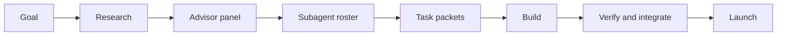

# Goal to Execution

> [!info] What this is
> The workflow for turning a goal into a researched plan, getting specialist advice, and splitting the work across subagents with clear ownership. It uses three global skills: `goal`, `advisor`, and `subagents`, which `senior-dev-os` can load automatically. The reasoning model is in [[Senior Developer Thinking]]; the project lifecycle continues in [[Senior Developer Operating System]].

> [!tip] The principle
> Do not jump from a goal to a task list. First find out what the goal actually requires, what the experts disagree about, and which specialist should own each part.

## The three skills

| Skill | Command | Answers | Output |
| --- | --- | --- | --- |
| `goal` | `/goal` | What outcome are we pursuing, and what does it take? | Goal brief, research summary, milestones, kill criteria |
| `advisor` | `/advisor` | What do the relevant experts think, and where do they disagree? | Advisory memo, recommendation, confidence, cheapest test |
| `subagents` | `/subagents` | Which specialist roles should do the work, and in what order? | Roster, subagent briefs, dependency graph, review gates |

They are connected:



`agent-delegation` handles the task packet and worktree mechanics. `project-kickoff` handles the software project baseline. `senior-dev-os` is the front door for the whole suite: it loads the relevant skills automatically, and each one remains directly accessible. This note covers the front of the funnel.

---

## 1. Define the goal

Use:

```text
/goal <what you want to achieve>
```

The skill turns the request into:

> I want **<outcome>** by **<date>** so that **<reason>**.

### What to provide

- The outcome, not the activity
- The deadline or decision date
- The reason it matters
- Fixed constraints: time, money, skills, access, compliance
- What you are deliberately not doing
- Any evidence you already have

If the goal is vague, the skill asks at most five questions. If it is usable, it proceeds with labelled assumptions instead of blocking.

### What the goal brief contains

| Section | Purpose |
| --- | --- |
| Statement | Outcome, date, reason |
| Success levels | Minimum, target, stretch |
| Metrics | Leading and lagging indicators |
| Constraints | Time, budget, skills, access, dependencies |
| Non-goals | The fence against scope creep |
| Research summary | Methods, tools, costs, prerequisites, failure modes |
| Resource inventory | What you have, need, and how you will get it |
| Milestones | Three to five outcomes with completion signals |
| First actions | Three things doable this week |
| Pre-mortem | Why this could fail and how to detect it early |
| Kill criteria | When to stop or change course |
| Operating model | Solo, advisor panel, subagents, or project OS |
| Review cadence | Weekly, monthly, milestone, deadline |

Template: `~/.agents/skills/goal/templates/goal-brief.md`.

### Research before planning

The goal skill searches for what already works. The questions:

1. What are the accepted methods or approaches?
2. What tools, platforms, and resources do practitioners actually use?
3. What are the prerequisites, and in what order?
4. What does it cost in time and money?
5. What are the common failure modes?
6. Who is already good at this, and what can be copied?
7. What benchmarks or examples show what "good" looks like?
8. What is the smallest test of demand or progress?
9. What can be bought, borrowed, or automated instead of built?
10. What would make this goal unnecessary or obsolete?

### Search map

| Goal type | Search for |
| --- | --- |
| Build a product | Similar products, pricing, user complaints, market size, distribution, build vs buy, regulations |
| Learn a skill | Curricula, prerequisites, practice methods, projects, benchmarks, plateaus |
| Start a business | Customer interviews, competitors, unit economics, licensing, acquisition, failure postmortems |
| Career | Role requirements, portfolios, referrals, salary bands, hiring processes, skill gaps |
| Creative work | Reference works, techniques, tools, distribution, audience, rights |
| Health or habit | Evidence-based protocols, contraindications, adherence, measurement |
| Operations | Baselines, bottlenecks, standards, automation, change management |

Use `research` for a deep pass, `firecrawl` for sources, and `advisor` to interpret the evidence.

### Success levels

Do not use one number. Define:

- **Minimum:** the smallest result still worth doing.
- **Target:** the expected outcome.
- **Stretch:** the result that changes the next decision.

Then define leading metrics (weekly behavior) and lagging metrics (the final result). Review evidence, not effort.

### Kill criteria

Decide in advance:

- The date by which a signal must appear.
- The budget or time cap.
- The quality or safety red line.
- The condition under which the goal is no longer worth pursuing.

Kill criteria are decision hygiene, not pessimism.

---

## 2. Get advice

Use:

```text
/advisor <the decision or plan>
```

The advisor is not a cheerleader. It frames the decision, chooses two to four specialist lenses, gets independent views, surfaces disagreement, and recommends with a confidence level.

### When to use it

- The decision is expensive to reverse.
- The plan looks convincing and you cannot see its weak points.
- Several specialists would disagree.
- You are entering an unfamiliar domain.
- You need a red-team review or pre-mortem.

### Lenses

| Lens | Optimizes for | Asks |
| --- | --- | --- |
| Product strategist | User value and focus | Who pays, why now, what is the wedge, what is out |
| Market researcher | Evidence about demand | Who competes, what do users hate, what will they pay |
| Software architect | Boundaries and reversibility | What changes together, what is the failure domain |
| Security and privacy | Loss prevention | Threat model, access, data lifecycle, logging |
| Data and analytics | Measurement quality | What is measured, how, what would make the number lie |
| UX and design | User comprehension | What is the user trying to do, what happens on error |
| QA and testing | Release confidence | What can break, what is the cheapest test |
| SRE and operations | Reliability and recovery | Deploy, fail, observe, rollback |
| Finance | Cash and return | Cost, margin, payback, downside |
| Legal and compliance | Avoidable liability | Regulation, contracts, data lifecycle |
| Marketing and distribution | Reach and conversion | Audience, channel, message, proof |
| Domain expert | Field norms | Accepted practice, regulation, beginner mistakes |

### Modes

| Mode | Use when |
| --- | --- |
| Single advisor | One lens is enough |
| Panel | The decision spans several domains |
| Red team | The plan looks convincing |
| Pre-mortem | Before committing |
| Decision review | Choosing between options |
| Second opinion | You already have a recommendation |

### Independence matters

If subagents are available, give each advisor the same brief and ask for an independent answer before showing anyone else's conclusion. Anchoring destroys the value of a panel.

The output is an advisory memo with:

- Bottom line
- Decision frame
- Facts, assumptions, unknowns
- Options and trade-offs
- Advisor views
- Where they disagree
- Recommendation and confidence
- Strongest counterargument
- What would change the recommendation
- Cheapest test

Template: `~/.agents/skills/advisor/templates/advisory-memo.md`.

### Professional limits

For medical, legal, tax, investment, or safety-critical decisions, the advisor gives general criteria and recommends a qualified professional. It does not diagnose, prescribe, or issue a definitive legal or financial ruling.

---

## 3. Choose the subagents

Use:

```text
/subagents <the work to split>
```

The point is specialization and clean ownership, not spawning many agents.

> [!note] In OpenCode
> Use the `subagent` tool. `explore` is for fast codebase reconnaissance; `general` is for multi-step research, implementation, review, or docs. Each call starts a fresh context, so include the full brief in the prompt. Pass the `sessionID` to continue the same conversation.

### The roster

| Role | Mission | Deliverable |
| --- | --- | --- |
| Goal lead | Keep outcome and scope coherent | Clarified goal, decisions |
| Domain researcher | Find evidence, methods, costs, failure modes | Research memo with sources |
| Product strategist | Define users, wedge, scope, metrics | Product brief, non-goals |
| Architect | Define boundaries, interfaces, technical shape | ADR, contracts |
| Implementer | Build one module or vertical slice | Diff, tests, report |
| Test engineer | Design tests and find edge cases | Test plan, automated tests |
| Security reviewer | Find auth, data, and abuse risks | Findings by severity |
| Data analyst | Define and check metrics | Metric definitions, queries |
| UX designer | Simplify flows and check accessibility | Flow, states, copy |
| SRE or DevOps | Make deploy, observe, and rollback safe | Runbook, dashboards, rollout |
| Docs writer | Make the work usable by the next person | README, ADR, guide |
| Red team | Attack the plan or implementation | Failure modes, test cases |
| Integrator | Own the seams and final verification | Merged result, verification report |

### How many agents

| Situation | Agents |
| --- | --- |
| Small, sequential, ambiguous | 1 |
| Independent research questions | 2–3 researchers |
| Build with stable interfaces | 2–3 implementers plus an integrator |
| High-stakes decision | 2–4 advisor lenses |
| Implementation plus independent review | 1 builder, 1 reviewer |
| Large multi-workstream goal | Serial phases of 2–4 agents |

More agents increase coordination cost, merge risk, and token spend. Add one only when it has a distinct mission and clean ownership.

### The subagent brief

Every role gets:

- Role and lens
- Mission in one sentence
- Why it matters
- Context and files to read
- Inputs
- Deliverable
- Scope in and out
- Allowed paths
- Acceptance criteria
- Verification
- Constraints
- Stop conditions
- Reporting format

Template: `~/.agents/skills/subagents/templates/subagent-brief.md`.

### Dependency order

```text
research → product decision → architecture → contracts
                                      ↓
                          implementation A ─┐
                          implementation B ─┼→ integration → verification → docs
                          tests ────────────┘
```

Rules:

- Research precedes decisions.
- Contracts precede parallel implementation.
- Shared files are serialized.
- Integration follows parallel work.
- Documentation follows verified behavior.
- The reviewer is independent from the builder.

### File ownership

One owner per file at a time. Serialize:

- Database schema and migrations
- Routers and route tables
- Shared types and interfaces
- Configuration and environment files
- Package manifests and lockfiles
- Design tokens and global styles

If two briefs list the same file, stop and fix the plan.

### Review gates

1. **Mission fit:** did the subagent do the assigned job?
2. **Scope:** did it stay inside the allowed paths?
3. **Correctness:** does the evidence or diff hold up?
4. **Quality:** does it follow the repo conventions?
5. **Verification:** run the commands yourself.

An agent's "done" is a status update, not evidence.

---

## 4. Hand off to execution

The subagent roster produces briefs. `agent-delegation` turns each brief into a task packet with:

- ID and title
- Goal and why
- Context
- Scope and allowed paths
- Acceptance criteria
- Verification commands
- Constraints
- Deliverable
- Stop conditions
- Handoff format

Then use worktrees or branches, one agent per worktree, no agent merges to main, and an integrator owns the final gate.

If the work is a software project, run `project-kickoff` after the goal is defined. It adds the product brief, architecture ADR, walking skeleton, vertical slices, and quality gates.

---

## Worked example: freelance invoicing SaaS

### Goal

> I want a freelance invoicing SaaS with 10 paying users by March 31 so the business has recurring revenue.

### Research

- Competitors: established invoicing tools are seen as bloated; freelancers want fast invoice creation and reliable payment links.
- Stack: TypeScript, Next.js, Postgres, Stripe, managed auth, error tracking.
- Cost: hosting and email are low; payment fees are per transaction.
- Failure modes: building tax and accounting features too early, delaying payment integration, poor invoice PDF quality.
- Smallest test: 10 freelancers create and send a real invoice during a concierge pilot.

### Advisors

| Lens | View | Concern |
| --- | --- | --- |
| Product | Wedge is "fastest invoice for a freelancer", not full accounting | Scope creep into expenses and reports |
| Architect | Modular monolith, invoice and payment modules | PDF generation and webhook retries are the risky seams |
| Security | Payment webhooks must be verified; tenant access must be server-side | Cross-tenant invoice access |
| Finance | Low infrastructure cost; payment fees dominate | Pricing must cover fees and support |

### Roster

| Phase | Roles | Output |
| --- | --- | --- |
| Discover | Domain researcher, product strategist | Pain points, pricing, wedge |
| Decide | Architect, security advisor, finance advisor | ADR, payment boundaries, unit economics |
| Build | Implementer A (invoices), Implementer B (payments), test engineer | Two slices and tests |
| Review | Security reviewer, red team | Findings and test cases |
| Integrate | Integrator | Merged result, full gate |
| Launch | SRE, docs writer | Runbook, rollback, changelog |

### First week

- [ ] Day 1: goal brief, non-goals, success metric.
- [ ] Day 2: advisor panel, architecture ADR.
- [ ] Day 3: walking skeleton, CI, preview deploy.
- [ ] Day 4: invoice and payment contracts, first slice.
- [ ] Day 5: subagent roster, first task packets.
- [ ] Day 6: build and review one vertical slice.
- [ ] Day 7: demo, review evidence, adjust the milestone.

---

## Anti-patterns

| Pattern | Problem | Fix |
| --- | --- | --- |
| Goal is an activity | No finish line | Define outcome and evidence |
| Research skipped | Repeating known mistakes | Search methods, costs, failures |
| One advisor lens | Blind spot | Use two to four lenses |
| Averaging disagreement | Loses the signal | Explain the disagreement |
| Too many agents | Coordination cost | Minimum viable roster |
| Generalist agents | Generic output | Assign explicit specialist roles |
| Overlapping file ownership | Merge conflicts | One owner per file |
| No integrator | Pieces do not compose | Assign an integration owner |
| No verification | "Done" but broken | Run the gates yourself |
| No kill criteria | Sunk-cost escalation | Decide stop conditions now |

## Checklist

- [ ] Goal statement has an outcome, date, and reason.
- [ ] Success levels and leading metrics are defined.
- [ ] Non-goals and constraints are written.
- [ ] Research covers methods, tools, costs, prerequisites, and failure modes.
- [ ] Resource inventory is honest.
- [ ] Three to five milestones have completion signals.
- [ ] Pre-mortem and kill criteria exist.
- [ ] Advisor lenses are chosen and independent.
- [ ] Recommendation includes confidence and dissent.
- [ ] Subagent roster is the minimum needed.
- [ ] Every role has a brief and a deliverable.
- [ ] Dependency order and file ownership are explicit.
- [ ] Review gates and an integrator are assigned.
- [ ] First three actions are doable this week.

## Commands and templates

| Resource | Path |
| --- | --- |
| Senior-dev command | `~/.config/opencode/commands/senior-dev.md` |
| Goal command | `~/.config/opencode/commands/goal.md` |
| Advisor command | `~/.config/opencode/commands/advisor.md` |
| Subagents command | `~/.config/opencode/commands/subagents.md` |
| Goal brief template | `~/.agents/skills/goal/templates/goal-brief.md` |
| Advisory memo template | `~/.agents/skills/advisor/templates/advisory-memo.md` |
| Subagent brief template | `~/.agents/skills/subagents/templates/subagent-brief.md` |
| Roster template | `~/.agents/skills/subagents/templates/roster.md` |

## Related notes

- [[Senior Developer Thinking]] — the reasoning model behind the workflow.
- [[OpenCode Skills]] — all 66 skills.
- [[Senior Developer Operating System]] — the project lifecycle after the goal.
- [[Full-Stack and Senior Developer Learning Map]] — learning path.

*Last verified: 2026-10-20.*
