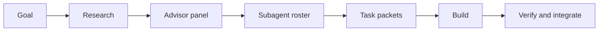
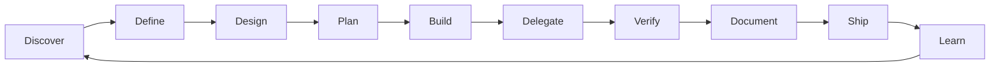

# Senior Developer Operating System

> [!info] What this is
> A practical operating system for starting and running software projects: how to define a goal, get specialist advice, structure the codebase, test, document, delegate to agents, and ship. It is implemented as ten global OpenCode skills and the `/senior-dev`, `/goal`, `/advisor`, and `/subagents` commands. The reasoning model lives in [[Senior Developer Thinking]]; the skill reference in [[OpenCode Skills]]; the goal workflow in [[Goal to Execution]].

> [!tip] The core idea
> Senior developers do not add more process. They frame the real problem, make trade-offs explicit, spend judgment on irreversible decisions, and keep batches small. With AI agents, **task clarity, context, and verification** matter more than ever. AI is an amplifier: it increases throughput and, without strong controls, instability.

## The suite

| Skill | Use it for | Main artifact |
| --- | --- | --- |
| `senior-dev-os` | Front door: senior thinking and automatic skill loading | Chosen workflow, composed skills |
| `goal` | Defining and researching an outcome | Goal brief, milestones |
| `advisor` | Getting specialist advice or a red-team review | Advisory memo |
| `subagents` | Choosing specialist roles and orchestrating them | Roster, subagent briefs |
| `project-kickoff` | Starting a product, feature, or client project | `docs/product-brief.md`, ADR, roadmap |
| `codebase-playbook` | Standardizing an existing repo | `AGENTS.md`, audit, gates |
| `testing-strategy` | Deciding what to test and which edge cases matter | `docs/testing-strategy.md` |
| `agent-delegation` | Splitting work across agents | Task packets, board |
| `documentation-system` | Making docs findable and current | README, ADRs, runbooks |
| `launch-readiness` | Shipping without avoidable surprises | Launch checklist, rollback |

The router `senior-dev-os` is the front door. It loads the smallest useful set of skills automatically; every skill is also directly accessible. You do not need to remember the names.

Invoke one directly:

```text
Use project-kickoff to turn this idea into a first milestone.
Use agent-delegation to split this plan across three agents.
```

Or use the commands:

```text
/senior-dev start a new client project for a booking system
/goal launch a freelance invoicing SaaS in six weeks
/advisor should we build auth or use a managed provider?
/subagents split this launch across specialist roles
```

## How senior developers think

The skills are downstream of a reasoning model. The short version:

| Principle | In practice |
| --- | --- |
| Problem before solution | Find the outcome underneath the request before choosing a stack. |
| Systems and second-order effects | Ask "and then what?" before merging; look for hidden coupling. |
| Reversibility | Slow down for one-way doors; move fast on two-way doors. |
| Trade-offs, not best practices | Name what you optimize for and what you give up. |
| Risk-first | Test the assumption that could kill the project before building the rest. |
| Leverage | Prefer the smallest change with outsized effect: remove, reuse, automate, delegate. |
| Boundaries | Define interfaces and ownership before parallel work. |
| Boring defaults | Novelty has an operating cost; clarity beats cleverness. |
| Own the outcome | "Done" means usable in production, not merged. |
| Write it down | Decisions, assumptions, and revisit conditions must survive the meeting. |
| Feedback loops | Measure stability as well as speed; review and run postmortems. |
| Multiply others | Review, mentor, document, and delegate with context. |

### Decision shape

| Door | Examples | Rigor |
| --- | --- | --- |
| One-way | Public API, data model, auth, pricing, data deletion | Advisor review, ADR, cheapest test, rollback plan |
| Two-way | Internal naming, UI copy, library choice, folder structure | Decide quickly, record one line, move |

### AI-era default

- **AI is an amplifier.** DORA's 2025 research associates higher adoption with both throughput and instability.
- **Context is the bottleneck.** Specs, `AGENTS.md`, task packets, and curated context matter more than prompt cleverness.
- **Spec before code.** Acceptance criteria and edge cases are the contract.
- **Small batches still win.** Generation is cheap; review, integration, and recovery are not.
- **Verification is the bottleneck.** Agent output is a draft, not evidence.
- **Judgment stays human.** Problem framing, architecture, risk, taste, and what not to build are the work.
- **Avoid deskilling.** Do some design, debugging, and code reading without AI.
- **Measure rework and instability**, not just speed.

The full synthesis, sources, and checklists are in [[Senior Developer Thinking]].

## From goal to execution

The front of the lifecycle:



1. **`/goal`** — define the outcome, research what it takes, set success metrics and kill criteria.
2. **`/advisor`** — get independent specialist views before committing to an expensive option.
3. **`/subagents`** — choose the minimum specialist roster and write a brief for each role.
4. **`agent-delegation`** — turn each brief into a task packet with file ownership and verification.
5. **`senior-dev-os`** — load the relevant lifecycle skills and execute; the router is the front door, not a gate.

Do not skip from goal to a large build. The research and advisor steps are how you avoid building the wrong thing efficiently.

## Lifecycle



The loop is deliberate. Shipping produces evidence that changes the next discovery.

---

## 1. Starting a project

### Start with a one-page brief, not a stack

Before choosing frameworks, answer:

- Who has the problem, and what do they do today?
- What outcome changes for them?
- How will you know it worked?
- What is explicitly out of scope?
- What constraint could kill the project: time, money, compliance, skills, or distribution?

If the answer is vague, propose a default and mark it as an assumption. A one-page brief that is 70% right beats a 20-page spec that nobody reads.

The brief contains: problem, users, outcome, success metric, scope, non-goals, constraints, risks, assumptions, open questions. Use the template at `project-kickoff/templates/product-brief.md`.

### Write down the non-goals

Scope creep rarely arrives as a big request. It arrives as "while we're here" and "this would be quick". Non-goals are the fence.

Examples for an invoicing MVP:

- No expenses, time tracking, or accounting sync.
- No multi-currency in v1.
- No team seats or approval workflows.
- No mobile app.

### Choose boring architecture

Defaults that survive most small-team projects:

| Decision | Default |
| --- | --- |
| Shape | Modular monolith, one deployable |
| Database | PostgreSQL |
| Auth | Managed provider |
| Payments | Stripe or local equivalent |
| Files | Object storage, signed URLs |
| Hosting | Vercel, Cloudflare, Railway, Fly, or Render |
| Background work | A small queue or scheduled job, not a platform |
| Observability | Sentry plus structured logs and a health check |

Avoid on day one: microservices, Kubernetes, custom auth, event sourcing, a plugin system, a design system, and abstractions for imagined reuse.

Write the decision as an ADR with alternatives and revisit conditions. `project-kickoff/templates/adr.md`.

### Build a walking skeleton first

The walking skeleton is the thinnest end-to-end system that deploys. It includes:

- Repo, README, `AGENTS.md`, `.env.example`
- Format, lint, typecheck, test, build
- CI and a preview deploy
- Health check, logs, error tracking
- Database connection and one migration
- One vertical slice through UI, API, and data
- Seed and reset commands
- Backup and restore path

If it cannot deploy, do not add features. Deployment is the first feature.

### Cut the first milestone into vertical slices

A slice is demoable on its own. A layer is not.

For each slice: outcome, acceptance criteria, touch points, risks, verification, dependencies. Three to five slices is enough for a first milestone. More means nothing finishes.

### First-week checklist

- [ ] One-page product brief approved.
- [ ] Non-goals written.
- [ ] Architecture ADR recorded.
- [ ] Repo created and deployed.
- [ ] CI gates running.
- [ ] Error tracking receiving events.
- [ ] Database migration works.
- [ ] First vertical slice demoed.
- [ ] `AGENTS.md` and README written.
- [ ] First task packet ready.

---

## 2. Managing the codebase

### Make it legible

A new developer or agent should answer these in under ten minutes:

- Where does a request enter?
- Where does business logic live?
- Where is the database schema?
- How do I run it?
- How do I test it?
- What must I not touch?

If not, the codebase has a documentation and structure problem, not a talent problem.

### Write `AGENTS.md`

`AGENTS.md` is the operating manual for AI agents. Keep it under ~150 lines. It needs:

- Purpose and stack
- Exact commands
- Architecture map
- Conventions
- Boundaries and generated files
- Verification commands
- Docs links
- Gotchas

Do not duplicate the README. The README is for humans getting started; `AGENTS.md` is for agents making changes.

### Record decisions with ADRs

Write an ADR when a decision is expensive to reverse, cross-cutting, surprising, or a deliberate departure from the default.

Keep it short: context, decision, alternatives, consequences, revisit conditions. Supersede old ADRs instead of rewriting history.

### Set quality gates

| Gate | Checks |
| --- | --- |
| Pre-commit | Format, lint staged files |
| Pull request | Lint, typecheck, unit tests, build |
| Integration | Contract or integration tests for changed boundaries |
| Preview | Deploy succeeds, smoke test |
| Main | Full suite, deploy |
| Nightly | E2E, dependency audit, performance budget |
| Release | Launch checklist |

A gate that can be bypassed is a suggestion. Require it in branch protection.

### Keep changes small

- One logical change per PR.
- Aim for under 400 changed lines.
- Split by behavior, not by file count.
- Include tests, migrations, and docs in the same change.
- Run the verification yourself before asking for review.

### Maintenance cadence

| Cadence | Activity |
| --- | --- |
| Weekly | Triage bugs, flaky tests, dependency alerts |
| Monthly | Dependency updates, dead code removal, docs freshness |
| Quarterly | Architecture review, access review, backup restore test |
| Yearly | Disaster recovery drill, major upgrade plan, cost review |

### Codebase health scorecard

Score 0–2 on: setup, structure, tests, CI, docs, observability, security, dependencies, release, agent readiness. Below 12 means fix foundations before features. Below 6 means stop feature work and stabilize.

---

## 3. Testing and edge cases

### Tests are risk management

Do not chase coverage. Ask: what can break, how bad is it, and what is the cheapest test that catches it?

| Level | Proves | Use for |
| --- | --- | --- |
| Unit | One module behaves | Logic, validation, calculations |
| Integration | Modules work together | Database, API, queues, auth |
| Contract | Producer and consumer agree | Public APIs, events, webhooks |
| E2E | A journey works | Login, checkout, signup |
| Property-based | Invariants hold | Parsers, money, permissions |
| Mutation | Tests detect faults | Critical algorithms |
| Performance | Budget is met | Hot paths, launch |
| Security | Attacks fail closed | Auth, input, uploads, payments |
| Accessibility | UI works with assistive tech | Primary journeys |

### Write test cases as a table

| ID | Scenario | Given | When | Then | Level |
| --- | --- | --- | --- | --- | --- |
| T-01 |  |  |  |  |  |

One observable outcome per case. If the Then contains "and", split it.

### Edge case checklist

**Input:** empty, null, whitespace, min/max, overflow, negative, unicode, long strings, invalid types, duplicates.

**State:** repeated use, idempotency, partial failure, retry, concurrency, stale cache, out-of-order events.

**Time:** time zones, DST, leap year, expiry, clock skew, double-scheduled jobs.

**Auth:** anonymous, expired token, wrong role, cross-tenant access, deactivated account, rate limit.

**Data:** missing, deleted, pagination boundaries, sorting and filters, large result sets, injection, file type and size.

**Network:** timeout, offline, slow, 4xx/5xx, 429, partial response, webhook retries.

**Money:** rounding, currency, tax, discounts, negative amounts, refunds, double charge.

**UI:** loading, empty, error, disabled, keyboard, screen reader, mobile, slow network, double click.

**Ops:** migration on real data, rollback, restore, missing env var, secret rotation, disk full.

### Test data

Use factories with valid defaults. Override only relevant fields. Keep tests independent. Use a dedicated test database. Never use production data without anonymization. Freeze time when time matters.

### Flaky tests

Quarantine, assign an owner, capture the seed and environment, fix the root cause. Do not add retries to hide a race condition.

---

## 4. Documentation

### Docs are an interface

With agents, documentation is not just for humans. `README.md`, `AGENTS.md`, ADRs, and runbooks are how the next session knows what to do.

### The docs map

```text
README.md                  # what, quickstart, architecture, deploy
AGENTS.md                  # agent operating manual
CHANGELOG.md               # user-facing changes
docs/
  product-brief.md
  roadmap.md
  testing-strategy.md
  onboarding.md
  adr/
  api/
  runbooks/
```

### Rules

- Docs live with the code and are reviewed in the same PR.
- Every document has an owner and a last-verified date.
- One source of truth. Link instead of copy.
- Commands must be copy-pasteable.
- Delete or archive stale docs.
- Generate API docs from the schema.
- Use `stop-slop` to remove filler.

### Runbooks

A runbook is for a person under pressure. It needs symptoms, access, diagnosis steps, remediation commands, rollback, verification, escalation, and post-incident actions. Test it before you need it.

### Freshness

Every PR updates affected docs. Monthly: link check and stale commands. Quarterly: a new person walks through onboarding. Before launch: execute the runbook.

---

## 5. Delegating to agents

### The equation

```text
output quality = task clarity × context quality × verification strength
```

Agents are capable but literal. They do not know your product, your conventions, or what you forgot to say. A task packet fixes that.

### The task packet

| Field | What it contains |
| --- | --- |
| ID and title | Stable reference |
| Goal | One sentence, outcome not activity |
| Why | User or business reason |
| Context | Files to read, docs, prior decisions |
| Scope | In and out |
| Allowed paths | Files or directories the agent may change |
| Acceptance criteria | Testable statements |
| Verification | Exact commands and manual checks |
| Constraints | Style, performance, security, dependencies |
| Deliverable | Diff, commit, report |
| Stop conditions | When to ask instead of guess |
| Handoff | What to report |

### Good vs bad task

| Bad | Why | Better |
| --- | --- | --- |
| "Build the dashboard" | No scope or acceptance | "Add `/dashboard` showing the last 10 orders for the signed-in user; use `OrderTable`; test empty/loading/error; do not change the API" |
| "Fix the tests" | No failure or cause | "`checkout.spec.ts:42` times out waiting for `#pay`; reproduce, find the root cause, fix without changing the test's intent" |
| "Refactor auth" | Cross-cutting and risky | "Extract `getSession()` into `session.ts`; keep public exports unchanged; all auth tests pass" |
| "Make it faster" | No metric | "Reduce `/api/search` p95 from 800 ms to under 300 ms on the seeded dataset; keep the response shape" |

### Decompose

1. Start from vertical slices.
2. Draw the dependency graph.
3. Size tasks to one module, one to three files, 30–90 minutes.
4. Partition by file ownership.
5. Fix interfaces before parallel work.
6. Add an integration task for the seams.

### Parallel rules

- One agent per worktree.
- One owner per file.
- No agent merges to main.
- Serialize shared files: schema, migrations, routers, types, config, lockfiles, global styles.
- The coordinator reviews and merges in dependency order.
- The coordinator reruns verification after integration.

### Review gates

1. **Spec compliance:** does it do what was asked, and only that?
2. **Correctness:** errors, permissions, validation, edge cases, idempotency.
3. **Quality:** conventions, simplicity, names, dead code, logs.
4. **Verification:** run the commands yourself. Agent claims are not evidence.

### Status protocol

```text
Task:
Status: done | blocked | needs review
Changed:
Verified:
Not done:
Risks:
Next:
```

Use a board at `docs/tasks/board.md`. A task is done when the acceptance criteria and verification pass, not when an agent says so.

### Handoff

When a task spans sessions, write: goal, what changed, what was verified, what is open, what to read first, what not to touch. Use the `handoff` skill.

---

## 6. Shipping

### Launch is a risk decision

Ask: what can fail, how bad is it, and can we recover? Not: is it done?

### Readiness dimensions

- **Product:** acceptance criteria, analytics, kill switch.
- **Security:** server-side authz, input validation, secrets, dependency scan, rate limits, PII.
- **Data:** migration on real data, backward compatibility, rollback, backup restore.
- **Reliability:** health checks, logs, errors, metrics, alerts, timeouts, retries.
- **Performance:** Core Web Vitals, p95 latency, indexes, caching.
- **Accessibility:** keyboard, screen reader, contrast, states.
- **Operations:** runbook, on-call, support, status page, cost.
- **Release:** changelog, canary or flag, rollback, post-deploy verification.

### Go/no-go

Any unmitigated critical security or data-loss risk is a no-go. Any red item without an owner is a no-go. Yellow can ship with monitoring and a rollback plan. If you cannot describe how to roll back, do not ship.

### Rollout

Staging → smoke test → internal or small cohort → watch errors, latency, and business metrics → expand gradually. Keep the kill switch until the monitoring window closes.

### Founder lens

1. What can kill the company if this goes wrong? Do not ship with an unmitigated risk.
2. What is reversible? Move fast there.
3. What can wait? Polish and non-critical refactors can follow.

---

## 7. Operating cadence

| Cadence | Practice |
| --- | --- |
| Daily | Small commits, clear PR descriptions, update the task board |
| Weekly | Demo the vertical slice, triage bugs and flaky tests, review agent output |
| Biweekly | Dependency and docs freshness check |
| Monthly | Architecture and access review, dead code removal, backup restore |
| Quarterly | Onboarding walkthrough, disaster recovery drill, roadmap reset |
| Per release | Launch checklist, monitoring window, postmortem if needed |

---

## 8. First seven days in any project

- [ ] Day 1: `/goal` brief, non-goals, success metric, research summary.
- [ ] Day 2: architecture ADR, choose boring defaults.
- [ ] Day 3: repo, CI, preview deploy, health check, error tracking.
- [ ] Day 4: database, migration, seed/reset, first vertical slice.
- [ ] Day 5: `AGENTS.md`, README, testing strategy, roadmap.
- [ ] Day 6: subagent roster, first task packet, and review gates.
- [ ] Day 7: demo the skeleton, review risks, adjust the milestone.

If the project already exists, start with `codebase-playbook` and run the audit instead.

---

## 9. What to customize per repo

The global skills provide the method. Each repo needs local truth:

| File | Local content |
| --- | --- |
| `AGENTS.md` | Commands, architecture, boundaries, gotchas |
| `README.md` | Setup, env vars, deploy |
| `docs/product-brief.md` | Users, problem, metrics |
| `docs/testing-strategy.md` | Levels, tools, edge cases |
| `docs/adr/` | Decisions and trade-offs |
| `docs/runbooks/` | Deploy, rollback, incident |
| `docs/tasks/board.md` | Current agent work |

Do not copy another project's `AGENTS.md`. Copy the structure, fill in the truth.

---

## 10. Common failure modes

| Failure | Symptom | Fix |
| --- | --- | --- |
| Stack-first | Debating frameworks before users | `project-kickoff` brief |
| Scope creep | "While we're here" | Explicit non-goals |
| No deployment | Works locally, not in prod | Walking skeleton |
| Giant PRs | Review takes days | Vertical slices |
| Coverage theater | High coverage, broken features | `testing-strategy` |
| Docs graveyard | Nobody trusts the docs | Owners, dates, one source |
| Agent firehose | Parallel agents conflict | `agent-delegation` |
| AI slop | Plausible generated code nobody understands | Spec, review, tests, ownership |
| Context dumping | More context, worse output | Curated `AGENTS.md` and task packets |
| Throughput without stability | Faster delivery, more incidents | Small batches, gates, observability |
| Deskilling | The human cannot judge the output | Do design and debugging without AI sometimes |
| No verification | "Done" but broken | Run the gates yourself |
| Launch by calendar | Known risks ship | `launch-readiness` go/no-go |

---

## Related notes

- [[Senior Developer Thinking]] — the reasoning model, research, and sources.
- [[OpenCode Skills]] — the full skill reference.
- [[Goal to Execution]] — goal, advisor, and subagent workflow.
- [[Full-Stack and Senior Developer Learning Map]] — learning path.
- [[Checklist]] — existing project checklist.

*Last verified: 2026-10-20.*
