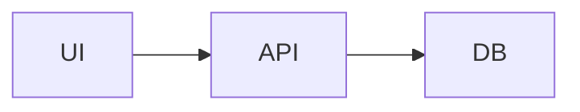

# <Project name>

<One sentence: what this is and who it is for.>

## Quickstart

```bash
# clone
# install dependencies
# copy environment file
# start the app
```

Open <http://localhost:3000>.

## Requirements

- Node/Python/other:
- Package manager:
- Database:
- External services:

## Environment

Copy `.env.example` to `.env` and fill in:

| Variable | Required | Purpose |
| --- | --- | --- |
|  |  |  |

Never commit real secrets.

## Scripts

| Command | What it does |
| --- | --- |
| `dev` |  |
| `build` |  |
| `test` |  |
| `lint` |  |
| `typecheck` |  |

## Architecture



- Entry points:
- Main modules:
- Data stores:
- Background jobs:
- External services:

## Testing

```bash
<test command>
```

See `docs/testing-strategy.md` for the full plan.

## Deployment

- Host:
- Staging:
- Production:
- Rollback:

See `docs/runbooks/deploy.md`.

## Documentation

- Product brief: `docs/product-brief.md`
- ADRs: `docs/adr/`
- API: `docs/api/`
- Runbooks: `docs/runbooks/`
- Agent instructions: `AGENTS.md`

## Ownership

- Owner:
- On-call:
- Support:
